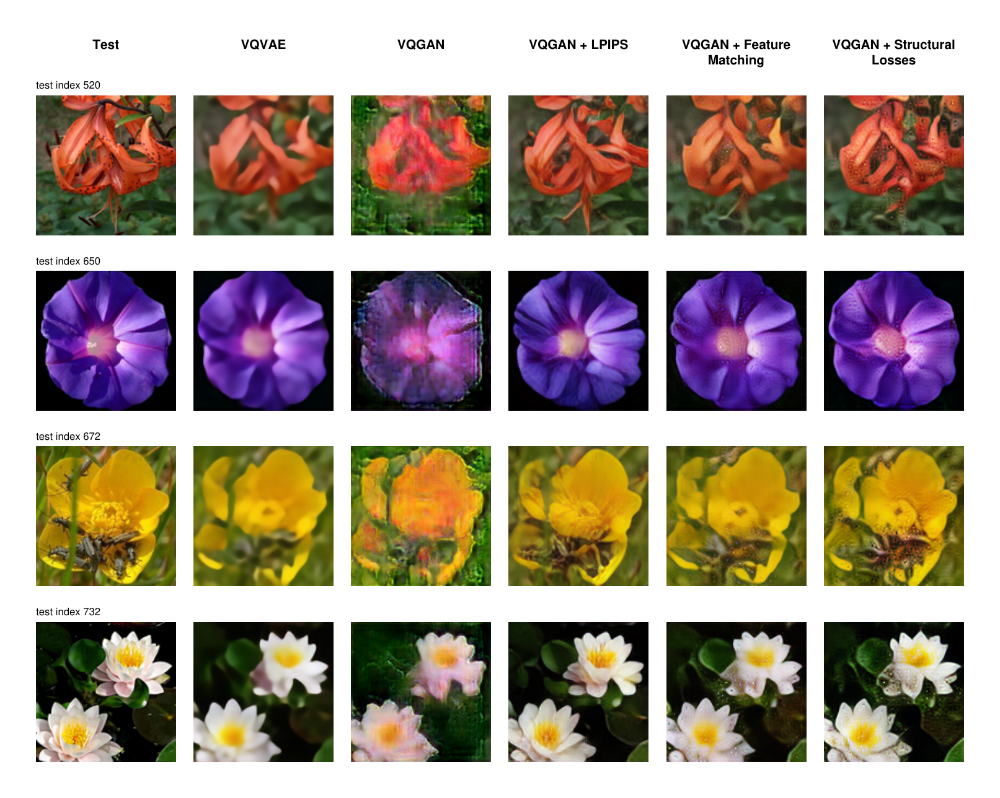

# VQVAE and VQGAN · JAX + Equinox

A shared convolutional vector-quantized autoencoder, trained as VQVAE or with a
separate PatchGAN discriminator as VQGAN.
Models are Equinox PyTrees; forward passes, gradient computation, and updates run
in JAX. Optax supplies AdamW and gradient clipping. The optional jaxlpips extra
provides a frozen pretrained VGG16 or AlexNet perceptual loss; it is disabled by
default, so its weights are downloaded only when requested.



*Flowers 102 test-set reconstructions after 30k steps: VQVAE, VQGAN, and VQGAN
with LPIPS, feature-matching, or structural losses.*

## Layout

```text
src/vqgan/
  config.py                 immutable, validated configuration
  models/
    blocks.py               shared residual, normalization, attention, resampling blocks
    autoencoder.py          encoder and decoder
    quantizer.py            chunked exact nearest-neighbour VQ
    vqvae.py                shared encoder → quantizer → decoder composition
    vqgan.py                compatibility aliases for the shared autoencoder
    discriminator.py        stateless PatchGAN
  losses/
    reconstruction.py       L1 or L2 pixel loss
    structural.py           MS-SSIM and multi-scale Laplacian losses
    quantization.py         codebook and commitment losses, usage metrics
    adversarial.py          GAN primitives and warm-up gate
    feature_matching.py     discriminator activation matching loss
    perceptual.py           optional frozen jaxlpips adapter and extension interface
    autoencoder.py          shared reconstruction/VQ objective and VQVAE loss
    generator.py            VQGAN adds adversarial loss to the shared objective
    discriminator.py        discriminator objective with detached fake images
  training/
    state.py                models, optimizer construction, optimizer states
    step.py                 JIT-compiled updates, no loss equations
    checkpoint.py           atomic save and restore
examples/train.py           runnable synthetic or .npy training example
tests/                      numerical, gradient-routing, and training checks
```

## Setup and smoke test

Use Python 3.11 or newer. Install the appropriate JAX accelerator build for your
hardware; ordinary `pip install` selects the CPU build.

```sh
python3.12 -m venv .venv
source .venv/bin/activate
pip install -e '.[dev]'
# Add frozen pretrained LPIPS for perceptual training:
pip install -e '.[perceptual]'
python examples/train.py --steps 5 --checkpoint checkpoints/smoke.eqx
python examples/train.py --model vqvae --steps 5 --checkpoint checkpoints/vqvae-smoke.eqx
pytest -q
ruff check src tests examples
```

The example uses a small architecture and 32×32 synthetic images. This verifies
the training pipeline; it does not produce a useful trained image model. The
first step includes compilation. Subsequent fixed-shape steps reuse the executable.

For real data, supply an NCHW `.npy` array of floating point images normalized to
`[-1, 1]`. The example memory-maps the dataset and transfers sampled batches:

```sh
python examples/train.py --data images.npy --steps 10000 --batch-size 8 \
  --disc-start 1000 --checkpoint checkpoints/train.eqx
python examples/train.py --data images.npy --steps 1000 --batch-size 8 \
  --disc-start 1000 --resume checkpoints/train.eqx
```

For the downloaded Flowers 102 dataset, see
[data_processing/README.md](data_processing/README.md). Its prepared uint8 arrays
are normalized per batch by the memory-mapped loader. The training example accepts
`--dataset-dir` for separate training/validation arrays, and `examples/evaluate.py`
evaluates saved checkpoints on validation or test data without training.

Adjust model configuration and warm-up for your dataset. Inputs use **CHW** for a
single image and **NCHW** for training. Image height and width must be multiples of
`ModelConfig.downsample_factor` (8 for the default architecture). PatchGAN also
requires each dimension to be at least `3 * 2**num_layers` (24 by default).
Reconstructions are unbounded; clip to `[-1, 1]` when displaying them.

## Minimal API

```python
import jax
from vqgan import (
    VQGAN, Discriminator, ModelConfig, DiscriminatorConfig, LossConfig,
    create_train_state, make_optimizers, make_train_step,
)

g_key, d_key = jax.random.split(jax.random.PRNGKey(0))
model = VQGAN(ModelConfig(), key=g_key)
discriminator = Discriminator(DiscriminatorConfig(), key=d_key)
optimizers = make_optimizers()
state = create_train_state(model, discriminator, optimizers)
train_step = make_train_step(
    optimizers, LossConfig(discriminator_start=10_000), donate_state=True,
)
# images: floating point (batch, 3, height, width), normalized to [-1, 1]
state, metrics = train_step(state, images)

# Inference: model calls operate on individual images; vmap supplies batching.
output = jax.vmap(state.generator)(images)
reconstructions = output.reconstruction
codes = output.indices
decoded = jax.vmap(state.generator.decode_codes)(codes)
```

Wrap inference in `eqx.filter_jit` for repeated fixed-shape calls. With
`donate_state=True`, replace the old state on every call: its buffers may be reused
and the old state must no longer be read. Image buffers remain usable.

## Train VQVAE alone or compare with VQGAN

`VQVAE` is the shared autoencoder class. The existing `VQGAN` name remains an
alias to the same implementation. The training mode determines whether PatchGAN
is instantiated and the adversarial objective is included.

```python
from vqgan import VQVAE, ModelConfig, LossConfig
from vqgan import create_train_state, make_optimizers, make_train_step

model = VQVAE(ModelConfig(), key=g_key)
optimizers = make_optimizers(mode="vqvae")
state = create_train_state(model, None, optimizers)
train_step = make_train_step(optimizers, LossConfig(), donate_state=True)
state, metrics = train_step(state, images)
```

VQVAE has no discriminator parameters, optimizer moments, or discriminator tracing
and computation. The optional perceptual hook remains available. GAN-specific
loss settings are unused in this mode, and GAN-specific metric keys are absent.
Shared metrics retain the `generator/*` prefix for comparison across modes.

Use the same data, seed, model size, batch size, precision, step count, and
augmentation settings for both runs, with different checkpoint paths:

```sh
python examples/train.py --model vqvae \
  --dataset-dir /Volumes/PortableSSD/datasets/oxford_flowers102/processed/128_seed0 \
  --steps 30000 --batch-size 2 --seed 0 --bf16 \
  --perceptual-weight 1.0 --perceptual-network vgg16 \
  --checkpoint checkpoints/flowers-vqvae-lpips-30k.eqx

python examples/train.py --model vqgan \
  --dataset-dir /Volumes/PortableSSD/datasets/oxford_flowers102/processed/128_seed0 \
  --steps 30000 --batch-size 2 --seed 0 --bf16 --disc-start 5000 \
  --perceptual-weight 1.0 --perceptual-network vgg16 \
  --checkpoint checkpoints/flowers-vqgan-lpips-30k.eqx
```

Both commands initialize identical autoencoder weights and sample/augment the
same batches. New runs default to VQGAN. Resume infers the mode and architecture
from `--resume`; an explicit conflicting `--model` fails early. The example does
not save sampler state, so this identical data ordering applies to uninterrupted
runs started with the same seed.

Evaluate either checkpoint with the same command and split:

```sh
python examples/evaluate.py \
  --dataset-dir /Volumes/PortableSSD/datasets/oxford_flowers102/processed/128_seed0 \
  --checkpoint checkpoints/flowers-vqvae.eqx --split validation --output vqvae-metrics.json
```

Repeat with the VQGAN checkpoint. Compare reconstruction metrics and image
quality on the same held-out examples; total training losses include different
terms, so their magnitudes are not directly comparable. Select settings on the
validation split, then evaluate the final models on the test split.

Generate a paired Markdown/JSON scorecard with pixel fidelity (L1, MSE, PSNR),
paired perceptual quality (SSIM, pretrained LPIPS-AlexNet), and distributional
quality (pretrained Inception-v3 reconstruction FID and KID):

```sh
python examples/evaluate.py \
  --dataset-dir /media/cisimon7/USB/datasets/oxford_flowers102/processed/128_seed0 \
  --checkpoint /media/cisimon7/USB/datasets/oxford_flowers102/checkpoints/flowers-vqvae.eqx \
  --compare-checkpoint /media/cisimon7/USB/datasets/oxford_flowers102/checkpoints/flowers-vqgan.eqx \
  --split test --batch-size 4 \
  --readme data_processing/previews/EVALUATION.md \
  --output data_processing/previews/evaluation.json
```

Install the optional metric stack with `pip install -e '.[metrics]'`. FID is
sample-size biased, so the generated report treats LPIPS as the primary paired
perceptual measure and reports KID alongside reconstruction FID. Pretrained
weights download once into the Torch cache.

Create a multi-page visual comparison using the same randomly selected test
images in `Test | VQVAE | VQGAN | VQGAN + LPIPS | VQGAN + Feature Matching |
VQGAN + Structural Losses` columns. Long headings wrap within their columns:

```sh
python examples/compare_reconstructions.py \
  --dataset-dir /media/cisimon7/USB/datasets/oxford_flowers102/processed/128_seed0 \
  --vqvae-checkpoint /media/cisimon7/USB/datasets/oxford_flowers102/checkpoints/flowers-vqvae.eqx \
  --vqgan-checkpoint /media/cisimon7/USB/datasets/oxford_flowers102/checkpoints/flowers-vqgan.eqx \
  --vqgan-lpips-checkpoint /media/cisimon7/USB/datasets/oxford_flowers102/checkpoints/flowers-vqgan-lpips-30k.eqx \
  --vqgan-feature-matching-checkpoint /media/cisimon7/USB/datasets/oxford_flowers102/checkpoints/flowers-vqgan-feature-matching-30k.eqx \
  --vqgan-structural-checkpoint /media/cisimon7/USB/datasets/oxford_flowers102/checkpoints/flowers-vqgan-structural-30k.eqx \
  --num-samples 12 --output comparison.pdf
```

## Training objectives

`losses/autoencoder.py` defines the common VQVAE objective:

```text
AE = reconstruction_weight × pixel_loss
   + perceptual_weight × perceptual_loss
   + ms_ssim_weight × (1 - MS-SSIM)
   + laplacian_weight × laplacian_pyramid_loss
   + codebook_weight × mean((embedding - stop_gradient(encoded))²)
   + commitment_weight × mean((encoded - stop_gradient(embedding))²)
```

`losses/generator.py` adds the adversarial term for VQGAN:

```text
G = reconstruction_weight × pixel_loss
  + perceptual_weight × perceptual_loss
  + codebook_weight × mean((embedding - stop_gradient(encoded))²)
  + commitment_weight × mean((encoded - stop_gradient(embedding))²)
  + effective_adversarial_weight × (-mean(D(reconstructed)))
  + feature_matching_weight × mean_layers(|stop_gradient(D_layer(real)) - D_layer(reconstructed)|)
```

Defaults: pixel L1 weight 1, codebook weight 1, commitment weight 0.25,
perceptual, feature-matching, MS-SSIM, and Laplacian weights 0, and adversarial
weight 1. All reductions and VQ distances use float32. Quantized decoder inputs
use the straight-through estimator: decoder gradients pass to the encoder, and
selected codebook vectors learn through the explicit codebook loss. The
commitment coefficient scales only the encoder term.

At `step < discriminator_start`, effective adversarial weight is zero and the
discriminator parameters **and optimizer state** remain unchanged. The compiled
conditional avoids executing discriminator forward/backward work during warm-up.
Setting adversarial weight to zero disables GAN updates throughout; choosing
`--model vqvae` also removes the discriminator and its optimizer entirely.

After warm-up, the default adaptive coefficient is
`clip(||grad_last_layer(reconstruction + perceptual)|| /
(||grad_last_layer(adversarial)|| + eps), 0, adaptive_weight_max)`.
It is detached and multiplied by `adversarial_weight`. The gradients are computed
with respect to the final decoder convolution's weights, reusing decoder features.
Set `adaptive_adversarial_weight=False` to use a fixed coefficient and save this
extra gradient computation.

`losses/discriminator.py` uses hinge loss:

```text
D = 0.5 × (mean(relu(1 - D(real))) + mean(relu(1 + D(fake))))
```

Generator gradients treat discriminator parameters as frozen. Discriminator
gradients use detached reconstructions from the generator forward pass before its
update; that forward pass is not repeated. There are separate AdamW states and
gradient clipping for the two models. GroupNorm avoids running batch statistics.
The metrics report raw loss components, their generator total, effective
adversarial weight, discriminator logits, and batch codebook usage/perplexity.

Set `--feature-matching-weight` to compare the discriminator's post-activation
features for real and reconstructed images. Real features and all discriminator
parameters are frozen in the generator update; gradients flow only through the
reconstruction. Feature matching shares the discriminator warm-up gate and needs
no external pretrained network.

For a stronger pretrained-free objective, combine
`--normalize-feature-matching`, `--ms-ssim-weight 0.2`, and
`--laplacian-weight 0.1`. Channel normalization makes feature comparison less
sensitive to the discriminator's changing activation magnitude. MS-SSIM supplies
stable multi-scale structure, while the Laplacian pyramid explicitly matches
detail bands. These structural terms are active from the first step; discriminator
feature matching begins at `discriminator_start`.

## Perceptual loss

Install `.[perceptual]`, then pass `--perceptual-weight 1.0`. The training CLI
uses frozen pretrained jaxlpips VGG16 weights by default, converts the project's
NCHW tensors to NHWC, and preserves gradients only through the reconstruction.
Inputs remain in the project's existing `[-1, 1]` range. Use
`--perceptual-network alexnet` to select the smaller alternative.

For a custom JAX feature loss, implement a callable accepting
`(target, prediction)` in NCHW format and returning a scalar or per-example losses:

```python
train_step = make_train_step(
    optimizers,
    LossConfig(perceptual_weight=1.0),
    perceptual_loss=frozen_feature_loss,
)
```

Enabling a positive weight without supplying a callable raises an error. A zero
weight avoids loading or calling jaxlpips. The pretrained feature network is not
part of the optimizer or checkpoint.

## Memory and speed controls

- **Chunked VQ:** nested JAX scans search token/codebook blocks. Per-image distance
  workspace is bounded by `min(tokens, token_chunk_size) ×
  min(codebook_size, codebook_chunk_size)`, rather than `tokens × codebook_size`.
  Batch `vmap` can multiply this workspace by batch size. Only chosen embeddings
  are gathered; usage statistics use counts, without dense one-hot matrices.
  Larger chunks can improve device utilization at the cost of more memory.
- **Rematerialization:** `remat=True` recomputes residual stages and bottlenecks
  during backward to retain fewer activations. Set it to false for more speed
  when memory permits. This is a compute/memory tradeoff.
- **Mixed precision:** `compute_dtype="bfloat16"` uses bf16 convolutions with
  float32 master parameters, normalization, VQ search, losses, and Adam moments.
  Try `--bf16` in the example. Speed benefits depend on accelerator support;
  float32 is the portable default. Float16 is not offered, avoiding loss scaling.
- **Bottleneck attention:** attention runs only at the lowest spatial resolution
  and uses JAX's attention primitive. The portable backend still has quadratic
  sequence workspace; disable `bottleneck_attention` for large latent grids.
- **Compilation and donation:** construct the step once, reuse batch shapes, and
  enable state donation when callers can relinquish the old state. Synchronize
  metrics only when logging, rather than on every step in a production loop.

These are implementation controls, not accelerator throughput guarantees. The
test suite exercises CPU execution; GPU throughput and real-data convergence
need to be measured on your target workload.

## Checkpoints

```python
from vqgan.training import save_checkpoint, load_checkpoint

save_checkpoint("checkpoints/train.eqx", state)
state = load_checkpoint("checkpoints/train.eqx", template=state)
```

Checkpoints record training mode, model parameters, the active optimizer states,
step, and model configuration metadata. VQVAE stores no discriminator state.
Existing version-1 VQGAN checkpoints remain readable. Loading requires a template
with the same model and optimizer structure; model configuration mismatches fail
early. Use the same
optimizer hyperparameters and loss settings when resuming, since these are
supplied by the training-step factory. The example does not persist dataset
sampler state; restore your sampler separately for reproducible data ordering.

## References

The adversarial objective and adaptive last-layer weighting follow the
[original VQGAN loss implementation](https://github.com/CompVis/taming-transformers/blob/master/taming/modules/losses/vqperceptual.py),
with frozen pretrained jaxlpips available for the perceptual term. Equinox's
[filtered transformations](https://docs.kidger.site/equinox/api/transformations/)
keep non-array configuration out of JIT and differentiate floating-point model
leaves. This implementation uses corrected, explicitly separated VQ gradient
terms and GroupNorm rather than the reference discriminator's batch statistics.
